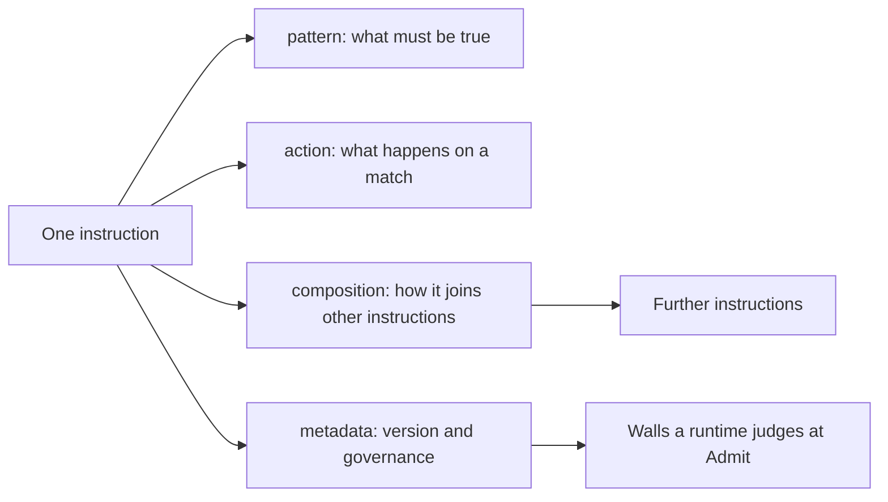
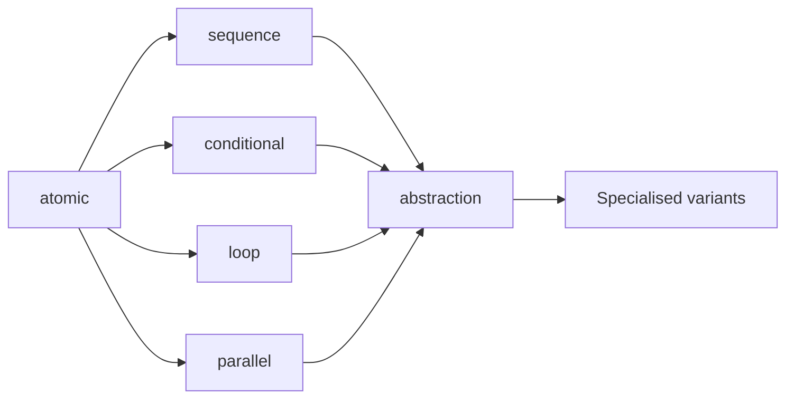
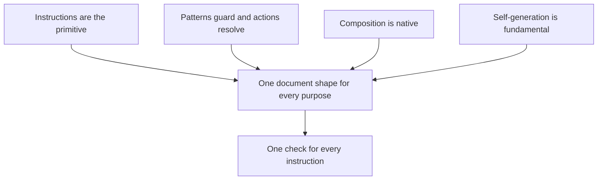
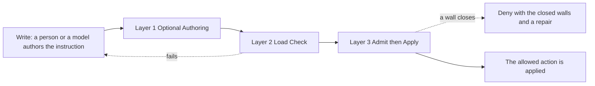
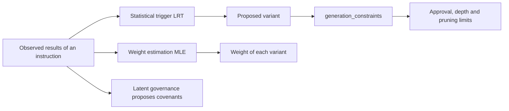
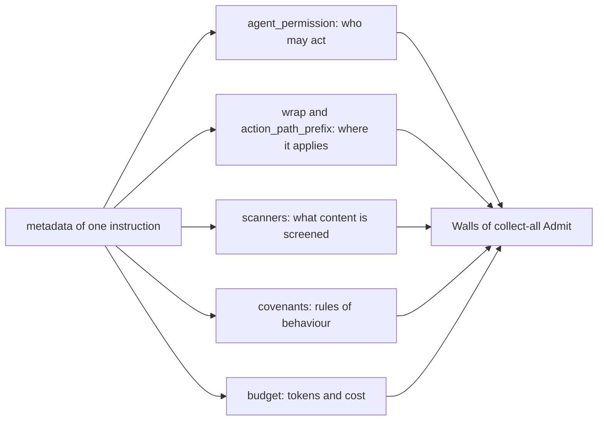
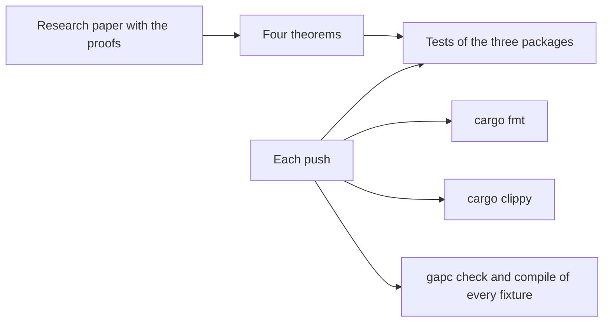
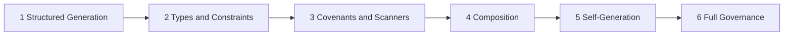

# GAP - Governed Agentic Programming

**Instructions language for governed, self-improving and mathematically verifiable agency**

**Version:** language specification v1.1 with the live meta schema v1.3, aligned to AEP 2.9.0  
**Author:** thePM_001 ([https://x.com/thePM_001](https://x.com/thePM_001))  
**Licence:** Apache-2.0  
**Public repository:** [https://github.com/thePM001/GAP](https://github.com/thePM001/GAP)  
**Research paper:** [https://github.com/thePM001/GAP-research-paper-002](https://github.com/thePM001/GAP-research-paper-002)

---

## What GAP is

GAP is the native instructions language for governed agency in the Agent Element Protocol and an instruction is the atomic unit so agents, workflows, validators, compositions and governance rules are all instructions that generate further instructions.

An instruction is one document in a `.gap` file. Its pattern states what must be true, its action states what happens when the pattern matches and its composition states how it joins other instructions. The governance of an instruction travels inside the same document, so a runtime that loads the instruction also loads the limits it must keep.



This repository holds the language: the meta schemas, the compiler `gapc` and two packages that judge an instruction. The runtime that applies instructions to live actions is the Agent Element Protocol, which the section GAP and AEP describes.

## Anatomy of an instruction

An instruction has eleven top level fields and six of them are required. The live meta schema is closed, so a field outside this table fails the check.

| Field | Required | What it holds |
| --- | --- | --- |
| `address` | yes | The `domain` and the `id` that name the instruction |
| `pattern` | yes | A text or an object with a guard, input, output, events, constraints and invariants |
| `action` | yes | What happens on a match, in one of five action types |
| `weight` | yes | A number from 0 to 1 that ranks the instruction among its alternatives |
| `composition` | yes | One of six composition types |
| `metadata` | yes | Provenance, version, stability and the governance fields |
| `types` | no | Type definitions that the pattern and the action refer to |
| `execution` | no | Retry, timeout and the behaviour on exhaustion |
| `weight_estimation` | no | Settings for the estimate of the weight from observed results |
| `enabled` | no | A flag that is read at load time. An instruction with the value false is still loaded and still judged |
| `extensions` | no | Data of a host that GAP does not read, one object per host |

The smallest legal instruction carries the six required fields:

```yaml
address:
  domain: com.example.finance
  id: pay.v1
pattern:
  guard: "true"
action:
  type: template
  content: pay
weight: 1.0
composition:
  type: atomic
metadata:
  provenance: "system.seed"
  version: "1.0.0"
  stability: experimental
  wrap: finance
  agent_permission:
    - finance.pay
```

A file uses the extension `.gap`, the encoding UTF-8 and YAML 1.2 or JSON as its syntax, with one instruction per document. [docs/FILE-FORMAT.md](docs/FILE-FORMAT.md) holds the full rules.

## Quick start

The toolchain needs a stable Rust toolchain with cargo and nothing else. Build the compiler and check every instruction of the tree:

```
cd packages
cargo build --locked -p gapc
target/debug/gapc check .
```

The check prints one line per file and a total:

```
ok ./gap-schema-profile-v13/fixtures/deployment.gap aep.reference.deployment/gate-policy.v2
ok ./gap-schema-profile-v13/fixtures/governance.gap aep.reference.governance/governance.v1
ok ./gap-schema-profile-v13/fixtures/security.gap aep.reference.security/policy-lattice.v1
ok ./gap-schema-profile-v13/fixtures/writing.gap aep.reference.writing/conventions.v1
gapc check: 4 files, 4 instructions, 0 failed
```

| Command | What it does |
| --- | --- |
| `gapc check <path>...` | Checks `.gap` files and every `.gap` file under a folder against the live meta schema and the load time walls |
| `gapc compile <file>` | Writes the JSON-encoded GAP of one source to standard output. With `--out <file>` it writes to a file |
| `gapc schema` | Prints the meta schema that the check uses |
| `gapc version` | Prints the versions of gapc, of the profile package and of the meta schema |

The exit status is 0 for a clean run, 1 when a source fails the check and 2 for a usage or file error. Save the smallest instruction above as a file with the extension `.gap` and run the check on it to see your own first line of output.

## 01 / Six Native Primitives

**What it is:** Composition is part of the language and not a library on top of it. Every instruction names one of six composition types, so a workflow is itself an instruction built from instructions.



| Composition type | Meaning | Fields it requires |
| --- | --- | --- |
| `atomic` | One instruction that stands alone | none |
| `sequence` | Instructions that run one after the other | `steps` |
| `conditional` | A choice between two instructions | `condition` and `then`, with an optional `else` |
| `loop` | An instruction that repeats until a condition holds | `body`, `until` and `max_iterations` |
| `parallel` | Instructions that run side by side and merge by all, any or majority | `branches` and `merge` |
| `abstraction` | A parameterised instruction with variants | none, with optional `parameters` and `variants` |

A sequence of three instructions is written like this:

```yaml
address:
  domain: com.example.support
  id: answer-ticket.v1
pattern: |
  Answer a support ticket in three governed steps.
action:
  type: template
  content: Classify the ticket, draft the answer and send it.
weight: 0.8
composition:
  type: sequence
  steps:
    - address:
        domain: com.example.support
        id: classify.v1
    - address:
        domain: com.example.support
        id: draft.v1
    - address:
        domain: com.example.support
        id: send.v1
metadata:
  provenance: "system.seed"
  version: "1.0.0"
  stability: experimental
```

The steps of a `pipeline` action are written with three operators: `→` pipes the output of one step into the next, `|` runs steps in parallel and `>>` is a gate that pauses for approval.

**What ships:** The live meta schema defines the six types and `gapc check` enforces the fields that each type requires. A runtime that executes a composition is not part of this tree.

**Where it lives:** The block `Composition` of [`schemas/gap-meta-schema-v1.3.json`](schemas/gap-meta-schema-v1.3.json).

**Run and test:** `target/debug/gapc check <file>` from the folder `packages` reports a composition that lacks a required field.

## 02 / Everything as Instruction

**What it is:** GAP has one building block. An agent, a workflow, a validator and a governance rule are all written as instructions. Four principles follow from that.



| Principle of the page | What it means in a file |
| --- | --- |
| Instructions Are the Primitive | There is no second kind of document. A policy and a prompt share one schema |
| Patterns Guard, Actions Resolve | The pattern decides whether the instruction applies and the action decides what is produced |
| Composition Is Native | Section 01 of this file |
| Self-Generation Is Fundamental | Section 04 of this file |

An action has one of five types:

| Action type | What it produces | Fields it requires |
| --- | --- | --- |
| `template` | Text from a template | `content` |
| `structured` | Output that follows a declared type | `schema` |
| `code` | Code in rego, javascript, python or typescript | `language` and `content` |
| `reference` | The result of another instruction | the address of that instruction |
| `pipeline` | The result of several steps | the list of steps |

A pattern is either a text or an object. The object form may carry a `guard`, typed `input` and `output`, an event subscription, `constraints`, `validators` and `invariants`. This instruction reviews pull requests and returns a typed result:

```yaml
address:
  domain: com.myorg.dev
  id: code-reviewer.v1
pattern: |
  Review pull requests for correctness, style and security.
action:
  type: structured
  schema: CodeReview
  structured_generation: true
  content: |
    You review pull requests for correctness, style and security.
    Every comment must reference a specific file and line number.
weight: 0.90
composition:
  type: atomic
metadata:
  provenance: "system.seed"
  version: "1.0.0"
  stability: stable
  grade: 8
  agent_permission:
    - review.pull_request
execution:
  retry:
    max_attempts: 3
    backoff: exponential
  timeout_ms: 30000
  on_exhaustion: fail
types:
  CodeReview:
    format: json
    fields:
      summary: string
      issues_found: boolean
      verdict:
        type: enum
        values: [approve, request_changes, comment_only]
```

The retry of an instruction at run time is written on the instruction itself, in the block `execution`.

**What ships:** Three meta schemas with v1.3 as the live one and four reference instructions as fixtures. Every example of this file passes `gapc check` and a test proves it on each push.

**Where it lives:** [`schemas/`](schemas/) for the meta schemas and `packages/gap-schema-profile-v13/fixtures/` for the reference instructions.

**Run and test:** `target/debug/gapc schema` prints the live meta schema and `target/debug/gapc check gap-schema-profile-v13/fixtures` checks the four fixtures.

## 03 / Write. Check. Admit.

**What it is:** GAP is enforced in three layers and no layer requires that a language model has seen GAP during training. Any model can author GAP instructions, because the check and the decision happen outside the model.



| Layer | Name on the page | What happens | Where it runs |
| --- | --- | --- | --- |
| 1 | Optional Authoring | A decoder may constrain the tokens of a model to the declared type. Constrained decoding is not Admit | In a decoder, when one is wired |
| 2 | Load Check | The instruction is validated against the meta schema and the load time walls before it becomes active | In `gapc check` |
| 3 | Admit then Apply | Every wall is judged together for one action. Only an action without a closed wall is applied | In the Base Node of AEP |

Authoring a `.gap` file is itself an instruction write, so the file reaches a runtime through the same Layer 3 as every other action. In live evaluation the proposal is sealed in a capsule, the clock is frozen at seal and the node waits 1000 ms before it runs every check together as collect-all Admit. If two walls fail both are listed. A close names the closed walls, their reasons and a prescribed repair. A retry must seal a new capsule, because the same sealed bytes are a replay. [docs/LIVE-EVALUATION.md](docs/LIVE-EVALUATION.md) describes that path with the kernel pulse, the derived ledger of fifteen rows and the trust bundle. [docs/GAP-AND-CONSTRAINED-DECODING.md](docs/GAP-AND-CONSTRAINED-DECODING.md) compares Layer 1 with tools for constrained decoding.

**What ships:** Layer 2 in full as `gapc`. Of Layer 3 the tree ships the walls that read an instruction and the walls that read a sealed capsule, each as a package with a binary. A decoder for Layer 1 is planned and the tree does not carry one. The clock freeze, the wait and Apply run in AEP.

**Where it lives:** [`packages/gapc/`](packages/gapc/), [`packages/gap-schema-profile-v13/`](packages/gap-schema-profile-v13/) and [`packages/gap-closed-wall-deny/`](packages/gap-closed-wall-deny/).

**Run and test:** `cargo test --locked --workspace` from the folder `packages` runs the tests of the three packages.

## 04 / Instructions Generate Instructions

**What it is:** An instruction of the type abstraction may ask for specialised variants of itself. The language describes when a new variant is proposed, how its weight is estimated and which limits the process must keep.



| Subject on the page | Fields of the language |
| --- | --- |
| Statistical Trigger (LRT) | `generation_constraints.lrt` with its switch, the significance level and the smallest sample per class |
| Weight Estimation (MLE) | The top level block for weight estimation with its switch, the smallest sample, the decay window and the floor |
| Latent Governance | `metadata.latent_governance` with its switch, the rejection threshold, the smallest number of observations and `auto_apply` |
| Limits of the process | `max_variants`, `min_quality_threshold`, `require_approval`, `max_generation_depth`, `pruning` and `promotion_threshold` |

```yaml
address:
  domain: com.example.support
  id: answer.v1
pattern: |
  Answer a customer question in the tone of the brand.
action:
  type: template
  content: Answer the question in two short paragraphs.
weight: 0.7
composition:
  type: abstraction
  parameters:
    - language
  self_generate: true
  generation_constraints:
    max_variants: 10
    min_quality_threshold: 0.92
    require_approval: true
    lrt:
      enabled: true
      significance: 0.01
weight_estimation:
  enabled: true
  min_samples: 50
metadata:
  provenance: "system.seed"
  version: "1.0.0"
  stability: experimental
```

**What ships:** The fields above with their ranges and defaults in the live meta schema, together with the check of their shape. A runtime that observes results, runs the test and generates variants is planned. The tree does not carry one.

**Where it lives:** The blocks `GenerationConstraints` and `Metadata` of the live meta schema in [`schemas/`](schemas/README.md).

**Run and test:** `target/debug/gapc check <file>` rejects a value outside its range, such as a significance level above 0.1.

## 05 / Structural Governance

**What it is:** The governance of an instruction is written in its own `metadata`. A runtime does not look up a second policy file, because the limits arrive with the instruction.



| Field of metadata | What it governs |
| --- | --- |
| `agent_permission` | Who may act. Each grant says that one agent may do one action. A grant is not a rank |
| `wrap` | The lattice wrap that the instruction binds to |
| `action_path_prefix` | The prefix of the action path that the instruction binds to |
| `scanners` | The content scanners to run, from the eleven names below |
| `covenants` | Rules of behaviour, each ending in `[hard]` or `[soft]` |
| `budget` | Limits for tokens and cost, with an optional daily cap |
| `proof` | Whether the result is signed and written to a ledger, with ed25519 or ml-dsa-65 as optional algorithms |
| `fleet` | The largest number of instances and the hourly cost cap |
| `knowledge` | The scope of the knowledge base and the switch against context rot |
| `tools` | The lists of allowed and forbidden tools |
| `aspect` | The classification label of the instruction |

The eleven scanner names are `pii`, `injection`, `secrets`, `jailbreak`, `toxicity`, `url`, `data_profiler`, `prediction`, `brand`, `regulatory` and `temporal`. A structured constraint or invariant carries one of three severities: `hard` blocks activation, `soft` is logged and `advisory` is information only.

```yaml
metadata:
  agent_permission:
    - review.pull_request
  wrap: governance
  scanners:
    - pii
    - secrets
    - injection
  covenants:
    - "every comment must reference a file and line number [hard]"
    - "verdict must be one of: approve, request_changes, comment_only [hard]"
  proof:
    sign: true
    algorithm: ed25519
    ledger: true
  budget:
    max_tokens: 30000
    max_cost: 0.50
```

Three rules decide the agent permission wall. A declared grant opens the wall for the named agent and action. A declared empty list closes every agent action. A document without the field leaves agent permission to other walls. The presence of `trust_ring`, of a rank or of a trust score on a live document is Deny and closes the wall `gap:leftover_rank_field`, so do not set these fields.

Writing and security are always-on stems and they evaluate on every action path. Every other instruction binds through its wrap or its prefix.

**What ships:** All governance fields in the live meta schema. The agent permission wall, the leftover rank wall, the wrap bind wall and the guard wall are code in the profile package. The scanners, the covenant evaluation and the budget count run in AEP, so this tree carries their names and not their engines.

**Where it lives:** [`packages/gap-schema-profile-v13/`](packages/gap-schema-profile-v13/README.md) for the walls and the block `Metadata` of the live meta schema for the fields.

**Run and test:** `cargo test --locked -p gap-schema-profile-v13` from the folder `packages`. The package README shows how to judge one request by hand.

## 06 / Mathematically Verified

**What it is:** The claims of GAP are stated as theorems and not as promises. The page names four of them: Admit then Apply, Self-Governance Fixed Point, Composition Preservation and Type Soundness.



**What ships:** The proofs are published in the research paper and not in this tree. The tree carries the executable side: tests for the reader, the walls, the collect-all rule, the digest and the retry, together with tests that hold this file, the versions and the schemas consistent. One test proves that two closed walls are both named in the answer of collect-all Admit.

**Where it lives:** The paper at [https://github.com/thePM001/GAP-research-paper-002](https://github.com/thePM001/GAP-research-paper-002), the tests under `packages/gapc/tests/`, `packages/gap-schema-profile-v13/tests/` and `packages/gap-closed-wall-deny/tests/` and the workflow [`.github/workflows/ci.yml`](.github/workflows/ci.yml).

**Run and test:** `cargo fmt --all --check`, `cargo clippy --locked --workspace --all-targets` and `cargo test --locked --workspace`, each from the folder `packages`. The workflow runs the same commands on a clean checkout.

## 07 / Six-Rung Ladder

**What it is:** A team adopts GAP in six rungs. Each rung adds governance without a rewrite of the logic that exists already.



| Rung | Name | What it adds | In this tree |
| --- | --- | --- | --- |
| 1 | Structured Generation | Output that follows a declared type, with optional Layer 1 authoring | The flag and the types. A decoder is planned |
| 2 | Types and Constraints | Typed input and output with validators and constraint expressions | The fields and the check of their shape |
| 3 | Covenants and Scanners | Rules of behaviour and content scanning | The fields. The engines run in AEP |
| 4 | Composition | Sequence, conditional, loop and parallel orchestration | The six types and the check of their required fields |
| 5 | Self-Generation | Specialisation from observed quality | The fields. A runtime is planned |
| 6 | Full Governance | Agent permission, the sha256-structure trust bundle and collect-all Admit then Apply | The walls of the two packages. The Base Node runs in AEP |

**What ships:** Every rung is expressible in the live meta schema today. The column In this tree states for each rung what this repository executes.

**Where it lives:** The whole tree. The ladder is a way to read it and not a folder.

**Run and test:** Start on rung 1 with the review instruction of section 02 and add one block per rung. Run `target/debug/gapc check` after each step.

## GAP and AEP

GAP is the language and the Agent Element Protocol is its runtime. The AEP repository at [https://github.com/thePM001/AEP-agent-element-protocol](https://github.com/thePM001/AEP-agent-element-protocol) holds the Base Node, the docks and the sandbox that enforce what GAP instructions declare.

- AEP holds a byte pinned copy of the profile package, of the meta schemas and of `gap-versions.toml`. Its check fails when a pinned byte differs.
- AEP keeps its own policy keys under `extensions.aep` of an instruction. The compiler and live Admit ignore that object.
- The reference instructions of an AEP runtime and the compile of sandbox profiles live in the AEP repository, in its folder for the GAP component.
- The trust bundle mode of live AEP 2.9.0 is sha256-structure. A proof algorithm that an instruction names is optional and is not the default attach.

A kernel loads policies as JSON-encoded GAP. The form below is legal GAP, because the kernel reads the instruction object and not its skin:

```json
{
  "address": {"domain": "aep.reference.writing", "id": "conventions.v1"},
  "pattern": {"guard": "true"},
  "action": {"type": "template", "content": "Apply AEP 2.9.0 writing conventions."},
  "weight": 1.0,
  "composition": {"type": "atomic"},
  "metadata": {"provenance": "AEP 2.9.0", "version": "1.0.0", "stability": "stable"}
}
```

[docs/GAP-AND-AEP.md](docs/GAP-AND-AEP.md) holds the detail, with the default sandbox profile for a coding agent.

## Packages and toolchain

The three packages form one cargo workspace under `packages/`. None of them is published to crates.io.

| Package | Binary | What it is |
| --- | --- | --- |
| [`packages/gapc/`](packages/gapc/README.md) | `gapc` | The GAP compiler with the commands check, compile, schema and version |
| [`packages/gap-schema-profile-v13/`](packages/gap-schema-profile-v13/README.md) | `gap-schema-profile-v13` | The live Admit profile: the reader of GAP source and the walls that read an instruction |
| [`packages/gap-closed-wall-deny/`](packages/gap-closed-wall-deny/README.md) | `gap-closed-wall-deny` | The closed wall Deny: the walls that read a sealed capsule, the digest and the retry |

The workflow of the repository runs four jobs on each push and each pull request: the format check, the lint with warnings denied, the tests and the check and compile of every fixture.

## Repository layout

| Path | What it holds |
| --- | --- |
| `README.md` | This file |
| `CHANGELOG.md` | The dated changes of the tree |
| `VERSIONING.md` and `gap-versions.toml` | The version rules and the version values |
| `LICENSE` | The Apache-2.0 licence text |
| `schemas/` | The meta schemas: `schemas/gap-meta-schema-v1.1.json`, `schemas/gap-meta-schema-v1.2.json` and `schemas/gap-meta-schema-v1.3.json` |
| `GAP meta schema v1.json`, `GAP meta schema v1.2.json` and `GAP meta schema v1.3.json` | Byte copies of the three schemas under their old names, kept for one release |
| `packages/` | The cargo workspace with the three packages |
| `docs/` | The documents of the tree, indexed in `docs/README.md` |
| `.github/workflows/ci.yml` | The workflow with the four jobs |

## Versions

GAP carries four kinds of version number: the language specification, the meta schema, each package and the AEP release that the tree is aligned to. The values live in `gap-versions.toml` and a test fails when the repository disagrees with that file. [VERSIONING.md](VERSIONING.md) states the rules, including the release that removes the old schema names at the root.

## Documentation index

| Document | Subject |
| --- | --- |
| [docs/README.md](docs/README.md) | Index of the documents under docs |
| [docs/FILE-FORMAT.md](docs/FILE-FORMAT.md) | The rules of a GAP file |
| [docs/LIVE-EVALUATION.md](docs/LIVE-EVALUATION.md) | How AEP judges an action against GAP instructions |
| [docs/GAP-AND-AEP.md](docs/GAP-AND-AEP.md) | Where the GAP tree and the AEP tree meet |
| [docs/GAP-AND-CONSTRAINED-DECODING.md](docs/GAP-AND-CONSTRAINED-DECODING.md) | Layer 1 and a comparison with dottxt |
| [docs/kernel-json-wrap.md](docs/kernel-json-wrap.md) | The JSON skin of kernel policies and how a wall binds |
| [schemas/README.md](schemas/README.md) | The live schema, the historical schemas and the old names |
| [CHANGELOG.md](CHANGELOG.md) | The dated changes |

## Licence

Apache-2.0. GAP is part of the Agent Element Protocol ecosystem.

## AI-eligibility status

To win the fight against the synthetic nano-parasites (SNP/NanoSinp) alien WMD, we must be intelligent and biosecure. It is recommended that bioinsecure humans do not use the provided technology/protocol to avoid bad techno-spiritual AI outcomes for them. [*"bioinsecure" = carries injectable synthetic nano-parasites growth medium controllers - SNP GMCs]

